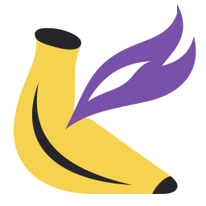

# libpotassium

libpotassium is an opinionated C++ wrapper for [libsodium](https://libsodium.org).

## Mapping libsodium APIs

For a supported libsodium family named `crypto_x_*`, import `potassium.x` and use the `potassium::x` namespace.
For example, `crypto_box_*` and `crypto_secretbox_*` map to `potassium.box` and `potassium.secretbox`, respectively.
Import `potassium` for the complete public API.

| Libsodium family                                                   | libpotassium mapping                                                                                                                                                |
|--------------------------------------------------------------------|---------------------------------------------------------------------------------------------------------------------------------------------------------------------|
| `crypto_hash_*` and `crypto_generichash_*`                         | `potassium.hash` provides SHA digests and both unkeyed and keyed BLAKE2b under `potassium::hash`.                                                                   |
| `crypto_auth_*`                                                    | Use `potassium::auth` for HMAC tags, one-shot authentication, and verification, and `potassium::hash::keyed_hasher<A>` for streaming.                               |
| Symmetric key generators such as `crypto_auth_keygen`              | `potassium.core` generates typed keys through `potassium::secret_key<KeyTag>`, `potassium::key_buffer_storage<KeyTag>`, and `potassium::make_secret_key<KeyTag>()`. |
| `sodium_init`, secure-memory utilities, and random byte generation | `potassium.core` exposes shared facilities such as `potassium::init`, `potassium::wipe`, and `potassium::random_fill` directly in `potassium`.                      |

Streaming HMAC moved to `potassium.hash` because it shares storage, finalization, and reset operations with keyed BLAKE2b.
For compatibility with libsodium's `crypto_hash()`, select `potassium::hash::sha512` explicitly.
`potassium::hash::default_algorithm` selects 32-byte BLAKE2b.

## Build and test

Use CMake 4.5 or newer, Ninja 1.11 or newer, development files for libsodium 1.0.22 or newer, and a C++26 toolchain whose `std` module exports `std::indirect` and whose compiler supports deleted functions with reasons.
The test suite requires Catch2 v3, which is available in the full Nix development shell.
To configure without the test suite, pass `-DBUILD_TESTING=OFF`.
See [HACKING.md](HACKING.md) for the pinned Nix development shell, toolchain details, and CLion setup.

```sh
cmake --preset debug
cmake --build --preset debug
ctest --preset debug
```

Run the example directly with `./build/debug/libpotassium_example`.
Use `release` in the same commands for an optimized build in `build/release`.

## API documentation

With Doxygen installed, enable and build the HTML documentation with the following commands.

```sh
cmake --preset docs
cmake --build --preset docs
```

Open `build/docs/docs/html/index.html` to browse the documentation.
The documentation option defaults to `OFF`.
If enabled while Doxygen is missing, CMake warns and skips the documentation target.

## Contributing

Follow the project rules in [AGENTS.md](AGENTS.md).
Enable soft wrapping in your editor so Markdown remains easy to read while keeping one sentence per line for focused diffs.

## AI usage

AI tools are used in developing libpotassium.
A human reviews and improves AI-assisted code, and pull requests containing AI-assisted code are accepted only after that manual review and improvement.
Each AI-assisted commit must attribute the assistance with a Git trailer in the following format.

```text
Assisted-By: Agent (Provider; underlying model)
```

## License

libpotassium is licensed under the [Boost Software License 1.0](LICENSE).
